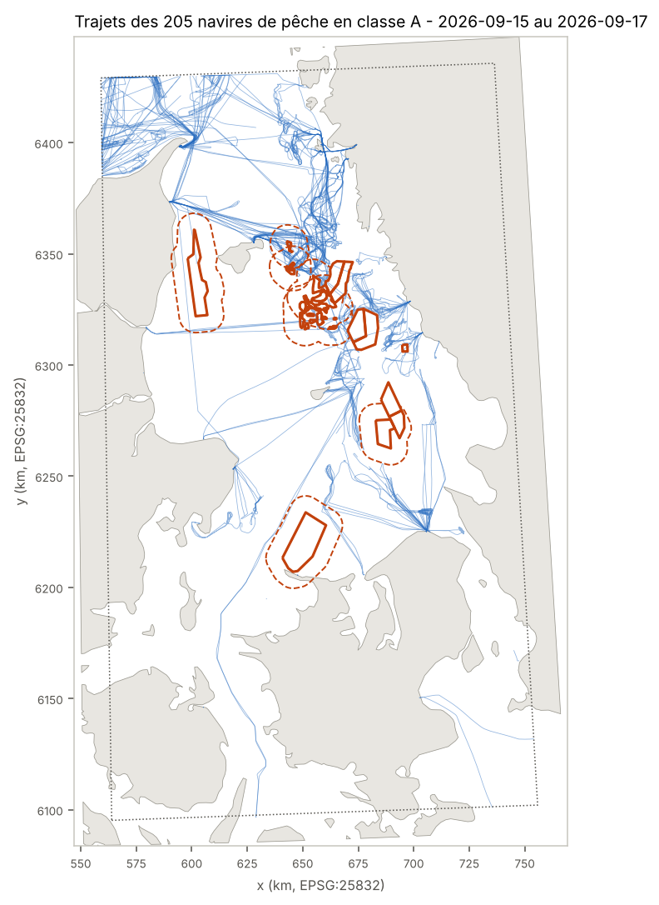
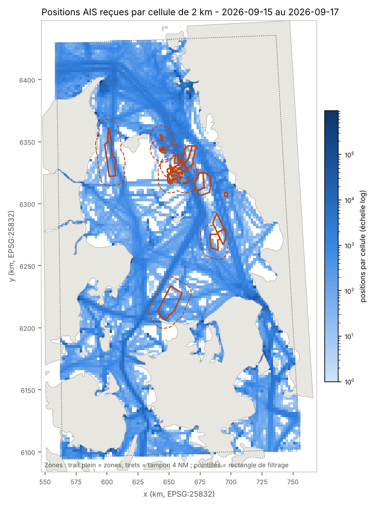

# Rapport de qualité des données AIS - Kattegat

Généré le 2026-10-10 par `src/04_report.py --month 2026-09`.

- **Source** : Danish Emergency Management Agency / dépôt `aisdata.ais.dk` (bucket S3 public `s3.eu-central-1.amazonaws.com/aisdata.ais.dk`).
- **Fichiers** : aisdk-2026-09-15.zip, aisdk-2026-09-16.zip, aisdk-2026-09-17.zip.
- **Période couverte** : 2026-09-15 au 2026-09-17 (3 jours, pas le mois complet).
- **Rectangle** : 55,0-58,0 N, 10,0-13,0 E.
- **Jeu produit** : `data/processed/ais_kattegat_2026-09.parquet/day=YYYY-MM-DD/` : **navires de pêche uniquement, messages de classe A uniquement**, triés par MMSI puis par horodatage (un trajet par navire). Les positions de tous les navires restent dans `data/interim/` pour la couverture et les comptages ci-dessous.

## 1. Nettoyage (compté, rien de retiré en silence)

| catégorie | traitement | 2026-09-15 | 2026-09-16 | 2026-09-17 | total |
|---|---|---|---|---|---|
| rows_read | lignes lues (fichier complet, tout le Danemark) | 18,479,837 | 17,806,145 | 17,547,320 | 53,833,302 |
| position_unavailable_set_null | lat = 91 / lon = 181 ou hors plage -> lat/lon mis à null | 39,490 | 27,919 | 30,153 | 97,562 |
| sog_unavailable_or_out_of_range_set_null | SOG > 102,2 nd (102,3 = non dispo) -> null | 3,724 | 3,773 | 2,586 | 10,083 |
| cog_unavailable_or_out_of_range_set_null | COG >= 360 -> null | 0 | 0 | 0 | 0 |
| heading_unavailable_or_out_of_range_set_null | Heading > 359 (511 = non dispo) -> null | 7,607 | 7,885 | 7,916 | 23,408 |
| rows_null_position_dropped | sans position -> retirées (non localisables) | 39,490 | 27,919 | 30,153 | 97,562 |
| rows_outside_bbox_dropped | hors rectangle 55-58 N / 10-13 E -> retirées | 9,175,813 | 8,742,926 | 8,535,159 | 26,453,898 |
| rows_in_bbox | dans le rectangle | 9,264,534 | 9,035,300 | 8,982,008 | 27,281,842 |
| exact_duplicates_dropped | doublons exacts (toutes colonnes) dans le rectangle -> retirés | 4,090,856 | 3,839,000 | 3,874,021 | 11,803,877 |
| mmsi_not_9_digits_flagged | MMSI sans 9 chiffres -> gardées, mmsi_is_9_digits = false | 137,977 | 132,307 | 131,737 | 402,021 |
| rows_written | lignes écrites dans le Parquet | 5,173,678 | 5,196,300 | 5,107,987 | 15,477,965 |
| rows_timestamp_outside_day | horodatage hors du jour du fichier | 0 | 0 | 0 | 0 |

Les doublons exacts sont nombreux (43% des lignes du rectangle) : vraisemblablement le même message reçu par plusieurs stations côtières et non fusionné par la source (non vérifié auprès de la DMA).

Les valeurs « non disponible » 102,3 (SOG), 360 (COG) et 511 (Heading) sont **absentes du CSV source** : la source semble déjà les publier vides. On ne trouve que lat = 91 (avec lon = 0) et des valeurs hors plage (sur le 15/09 : SOG jusqu'à 168 nd, Heading jusqu'à 510), mises à null ci-dessus.

## 2. Messages et navires

| | messages | MMSI uniques |
|---|---|---|
| total | 15,399,000 | 3,061 |
| classe A (`Type of mobile` = « Class A ») | 13,252,012 | 1,329 |

Par type d'émetteur :

| mobile_type | messages | mmsi_uniques |
|---|---|---|
| Class A | 13,252,012 | 1,329 |
| Class B | 1,560,273 | 2,023 |
| Base Station | 371,398 | 14 |
| AtoN | 211,867 | 37 |
| SAR Airborne | 3,100 | 6 |
| Search and Rescue Transponder | 310 | 7 |
| Emergency PIRB | 34 | 9 |
| Man Overboard Device | 6 | 1 |

365 MMSI apparaissent sous plusieurs types d'émetteur (ex. A et B) : `is_class_a` est calculé **par message**, pas par navire.

## 3. Navires candidats pêche

`is_fishing_candidate` = le type de navire le plus fréquent déclaré par le MMSI (messages statiques, sur toute la période et tout le fichier) vaut « Fishing », libellé de la DMA pour le code AIS 30.

- **244 navires candidats pêche** dans le rectangle, dont 205 avec au moins un message de classe A et 39 uniquement en classe B.
- 198 MMSI n'ont aucun type déclaré sur la période (ni pêche ni autre) ; 4 MMSI déclarent plusieurs types.
- 62 candidats pêche déclarent moins de 12 m, dont certains en classe A : longueur AIS à vérifier (champ souvent mal saisi).
- 6 MMSI non classés pêche émettent pourtant le statut « Engaged in fishing ».

Répartition par longueur déclarée (champ AIS `Length`, valeur la plus fréquente par MMSI) :

| longueur | navires | dont classe A | dont classe B uniquement |
|---|---|---|---|
| < 12 m | 62 | 32 | 30 |
| 12-15 m | 32 | 30 | 2 |
| 15-18 m | 61 | 57 | 4 |
| 18-24 m | 35 | 35 | 0 |
| 24-40 m | 23 | 22 | 1 |
| >= 40 m | 22 | 22 | 0 |
| inconnue | 9 | 7 | 2 |

Rappel : l'AIS n'est obligatoire que pour les navires de pêche de plus de 15 m. Les navires plus petits sont donc en partie invisibles ; leur absence n'est pas une anomalie.

## 4. Jeu final : trajets des navires de pêche en classe A

Filtre : `is_fishing_candidate` (type déclaré « Fishing ») **et** `is_class_a` (message émis par un transpondeur de classe A). Un navire de pêche qui émet parfois en classe B ne garde que ses messages de classe A.

| positions | navires | début | fin |
|---|---|---|---|
| 3,633,362 | 205 | 2026-09-15 00:00:00.000000+00:00 | 2026-09-17 23:59:58.000000+00:00 |

| positions par navire (médiane) | min | max | navires avec statut « Engaged in fishing » |
|---|---|---|---|
| 21,242 | 127 | 41,019 | 123 |

Les positions successives sont reliées sans interpolation : une longue ligne droite (parfois à travers la terre) relie deux positions séparées par un trou de signal ou une sortie du rectangle. C'est exactement ce que le futur détecteur devra qualifier.

## 5. Carte de couverture

Positions des émetteurs mobiles (stations de base et balises AtoN exclues), après dédoublonnage, comptées par cellule de 2000 m en EPSG:25832.

- 8,545 cellules avec au moins une position.
- Positions par cellule non vide : médiane 247, p90 2519, p99 23004.
- La densité mesure **trafic × réception** : une cellule vide peut être une zone sans navire autant qu'une zone mal couverte.

Rectangle affiné : Enveloppe des zones et tampons : 55.920-57.446 N, 10.505-12.235 E. Rectangle affiné proposé : cette enveloppe plus une marge de 0,1°.

## 6. Intervalles entre messages par navire

Différence entre deux messages successifs d'un même MMSI, sur les messages dédoublonnés du rectangle, MMSI à 9 chiffres, stations fixes exclues.

| groupe | intervalles | navires | = 0 s | médiane | p90 | p99 | p99,9 | max | > 10 min | > 1 h |
|---|---|---|---|---|---|---|---|---|---|---|
| tous (mobiles) | 14,782,104 | 2,957 | 0.5% | 10 s | 31 s | 4.4 min | 12.9 min | 60.7 h | 0.17% | 0.021% |
| classe A | 13,223,377 | 1,316 | 0.5% | 10 s | 19 s | 3.0 min | 6.0 min | 60.7 h | 0.04% | 0.007% |
| classe B | 1,555,300 | 1,984 | 0.2% | 57 s | 3.3 min | 11.7 min | 88.5 min | 59.6 h | 1.26% | 0.143% |
| pêche, classe A | 3,633,157 | 205 | 0.3% | 10 s | 19 s | 41 s | 3.1 min | 50.8 h | 0.02% | 0.003% |
| pêche, classe B | 46,124 | 80 | 0.5% | 88 s | 4.2 min | 11.8 min | 56.4 min | 39.1 h | 1.31% | 0.082% |

| médiane des médianes par navire (s) | médiane des plus grands trous par navire (s) | navires avec au moins un trou > 1 h |
|---|---|---|
| 30.0 | 540.0 | 899 |

Un grand intervalle peut venir d'un trou de signal, d'un AIS éteint, d'un navire **sorti du rectangle** puis revenu, ou d'un navire au port. Ces cas ne sont pas encore distingués. Les intervalles nuls correspondent à deux messages non identiques avec le même horodatage à la seconde près (quasi-doublons, gardés).

## 7. Limites

**Vérifié dans les données ou la source :**
- Le schéma : 26 colonnes, en-tête lu dans le CSV et conforme au README du dépôt (`!_README_information_CSV_files.txt`). Séparateur décimal : point.
- Les horodatages sont tous dans le jour du fichier (format `JJ/MM/AAAA HH:MM:SS`).
- Le type de navire est un libellé texte (« Fishing »), pas un code numérique, et il est souvent « Undefined » sur les messages de position. D'où la résolution par MMSI.
- Les MMSI de stations de base n'ont que 7 chiffres dans la source (zéros de tête absents). Ils sont lus en texte et signalés, pas corrigés.
- Le tampon de 4 NM (7 408 m) est calculé en EPSG:25832, et le calcul a été testé sur un carré de test.

**Supposé, non vérifié :**
- Les horodatages sont en UTC : le README dit seulement « Timestamp from the AIS basestation ».
- « Fishing » correspond au code AIS 30, d'après la table ITU-R M.1371 ; la table de correspondance de la DMA n'a pas été vue.
- `aisdata.ais.dk` est l'hébergement officiel actuel. La page dma.dk n'était pas accessible depuis l'environnement ; le dépôt porte le nom aisdata.ais.dk et sa page d'index y renvoie.
- Les doublons exacts viennent de la réception multi-stations.
- La longueur AIS déclarée est juste ; elle n'a pas été comparée à un registre.

**Non fait :**
- **Sites Natura 2000 et aires HELCOM** : domaines EEA et HELCOM bloqués par la politique réseau de l'environnement ; vérification croisée des zones non faite (voir `reports/protected_sites_check.md`). Les zones du règlement 2022/952 sont, elles, extraites et contrôlées (`reports/zones_check.md`).
- La période ne couvre que 3 jours au lieu d'un mois (choix validé) : les statistiques de longueur et d'intervalles sont indicatives.
- Pas de contrôle de cohérence cinématique (sauts de position, vitesses implicites) : c'est le travail du détecteur, hors périmètre.
